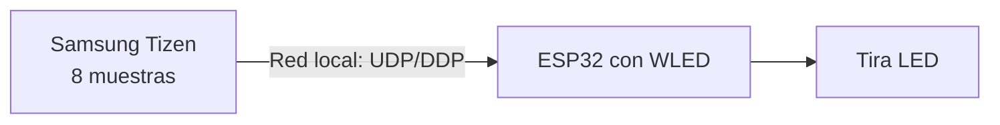

# HyperTizen WLED Direct

Ambilight desde un televisor Samsung Tizen directamente a WLED mediante UDP/DDP. Deriva de [lowryn/HyperTizen](https://github.com/lowryn/HyperTizen), basado en [reisxd/HyperTizen](https://github.com/reisxd/HyperTizen). Conserva la salida original a HyperHDR.

**Compatibilidad comprobada:** Samsung QN75Q7FAAGCZB con Tizen 9, ESP32 clásico con WLED y tira SM16703 de 120 LED físicos agrupados en 40 píxeles RGB direccionables. Se confirmó funcionamiento con Netflix, YouTube y TV en ese dispositivo. No hay pruebas de compatibilidad universal.

## Índice

- [Funcionamiento](#funcionamiento)
- [Materiales y conexiones](#materiales-y-conexiones)
- [Preparar WLED](#preparar-wled)
- [Instalación](#instalación)
- [Comandos para Windows](docs/INSTALACION_WINDOWS.md)
- [Configurar los LED](#configurar-los-led)
- [Compilar](#compilar)
- [Problemas frecuentes](#problemas-frecuentes)
- [Preguntas frecuentes](#preguntas-frecuentes)
- [Créditos y licencia](#créditos-y-licencia)

## Funcionamiento



La TV toma ocho muestras de la pantalla mediante `libvideoenhance.so`, las distribuye entre los píxeles configurados y envía colores a WLED por UDP 4048. Una vez instalado y configurado, no necesita PC, HyperHDR, capturadora HDMI ni cámara. El suavizado puede enviar colores interpolados cerca de 30 veces por segundo, pero **no aumenta los FPS reales de captura**: en la TV probada son aproximadamente 5–6 FPS.

## Materiales y conexiones

Se necesita una TV Samsung compatible, ESP32 con WLED, tira direccionable, fuente regulada adecuada, cables y conectores. Según la tira, puede hacer falta un adaptador de nivel lógico. Los 120 LED físicos de la configuración probada equivalen a **40 píxeles direccionables**.

**Seguridad eléctrica:** desconectá la alimentación antes de cablear. Uní GND de la fuente, tira y ESP32. Conectá datos al extremo de entrada de la tira. Alimentá la tira desde una fuente externa adecuada, nunca a través de la TV o del ESP32. Dimensioná fuente, cables, protección e inyección de energía según el consumo máximo; verificá el voltaje y protocolo reales de tu tira. Si no estás seguro, consultá a alguien calificado.

## Preparar WLED

1. Instalá WLED siguiendo su [guía oficial](https://kno.wled.ge/basics/install-binary/).
2. Conectá TV y ESP32 a una red local donde puedan comunicarse. Reservá una IP estable para el ESP32.
3. Configurá en WLED el controlador, pin, orden RGB y cantidad de **píxeles direccionables**; en el equipo probado son 40.
4. Activá la recepción DDP en UDP 4048 y verificá que WLED responde antes de diagnosticar la TV.

## Instalación

### Opción gráfica: TizenBrew Installer Desktop (todavía experimental con este paquete)

[TizenBrew Installer Desktop](https://github.com/reisxd/TizenBrewInstaller) permite elegir un `.tpk` local y contiene código para volver a firmar paquetes en Tizen 7+. Todavía no probamos la instalación **de este servicio** por ese método en otra TV. Descargá únicamente una versión oficial del instalador, activá el modo desarrollador, conservá el paquete que ya te funciona y seguí las indicaciones de firma con tu propia cuenta Samsung. Un paquete firmado para otra TV no es universal. Aún no hay binario genérico público de este proyecto.

### Método comprobado: Tizen Studio

Para una explicación paso a paso, incluidos conexión, firma, registros y restauración, seguí la [guía de instalación en Windows](docs/INSTALACION_WINDOWS.md).

Instalá [Tizen Studio y el TV SDK](https://developer.samsung.com/smarttv/develop/getting-started/setting-up-sdk/installing-tv-sdk.html), activá el modo desarrollador y creá tu [perfil de certificado Samsung](https://developer.samsung.com/smarttv/develop/getting-started/setting-up-sdk/creating-certificates.html). Desde PowerShell en la raíz del repositorio:

```powershell
dotnet build -c Release
$tizen = '<TIZEN_STUDIO>\tools\ide\bin\tizen.bat'
$carpeta = 'HyperTizen\bin\Release\tizen90'
& $tizen package -t tpk -s '<TU_PERFIL>' -- "$carpeta\io.gh.reisxd.HyperTizen-1.0.0.tpk"
& $tizen install -n io.gh.reisxd.HyperTizen-1.0.0.tpk -- $carpeta
& $tizen run -p io.gh.reisxd.HyperTizen
```

La IP del ESP32 se carga **en la TV**, en la pantalla **HyperTizen WLED Direct** de TizenBrew; no hace falta ejecutar el script PowerShell que usamos durante las pruebas. Para abrir esa pantalla, instalá [TizenBrew](https://github.com/reisxd/TizenBrew), entrá en **Administrador de módulos → Añadir módulo GitHub** y escribí `matitoud/HyperTizen-WLED` (sin `gh/`). Abrí el módulo agregado. Este repositorio incluye un `package.json` en la raíz para que TizenBrew pueda encontrar la interfaz. Si TizenBrew muestra «Unknown Module», verificá que el último cambio ya esté en GitHub y reiniciá TizenBrew.

## Configurar los LED

En la pantalla **HyperTizen WLED Direct**, seleccioná **WLED DDP** y escribí la IP local del ESP32 en **IP de WLED** (por ejemplo, `192.168.1.100`; usá la dirección real de tu WLED). Con el control remoto, usá **↑/↓** para moverte, **OK** para abrir un campo, las flechas y **OK** para escribir con el teclado de la app, **Listo** para confirmar o **Volver** para cancelar. El campo seleccionado lleva un borde amarillo visible. Especificá el total de píxeles direccionables y los correspondientes a arriba, derecha, abajo e izquierda; los cuatro lados deben sumar el total. Pulsá **Guardar configuración de WLED** y luego marcá **Activado**. El recorrido lógico comienza arriba a la izquierda y sigue en sentido horario. El píxel inicial desplaza el mapeo; invertir dirección corrige el cableado contrario.

Como punto de partida para 40 píxeles: 12 arriba, 8 derecha, 12 abajo y 8 izquierda. Ajustalo a tu montaje. Probá el suavizado activado y desactivado; 120–180 ms suele ser un rango inicial razonable. Un tiempo mayor reduce tirones pero aumenta la demora visual. El `.tpk` de esta copia escucha solo en `127.0.0.1`. Para conservar compatibilidad con un `.tpk` funcional anterior que escucha en la red local, la interfaz prueba primero `127.0.0.1` y luego la IP de **la propia TV** obtenida mediante la API de Samsung. Si la detección falla, aparece **«IP de esta TV»**: ingresá ahí la dirección de la TV, distinta de la IP del ESP32, y pulsá **Conectar con HyperTizen**. Esa dirección se guarda solo en el almacenamiento local de la interfaz. No exponer el puerto de configuración a Internet.

## Compilar

Se necesitan .NET SDK, Tizen Studio TV SDK y un perfil de firma propio. Ejecutá `dotnet build -c Release` en la raíz, firmá el `.tpk` generado e instalalo como arriba. `HyperTizen` es el servicio y `HyperTizenUI` la interfaz. Los paquetes firmados y directorios `bin/` y `obj/` no se publican en Git.

## Problemas frecuentes

| Problema | Revisá |
| --- | --- |
| Tira apagada | IP y red local, UDP 4048, modo WLED, servicio activado y cantidad de píxeles. |
| Colores en otro lado | Cantidades por lado, píxel inicial y dirección. |
| Movimiento a tirones | Activá suavizado y compará FPS de captura con FPS de envío en los registros `WLED perf`. |
| Mucha demora | Bajá la transición hacia 120 ms o desactivá suavizado. |
| Error de certificado | Firmá con tu propio perfil Samsung y el identificador de tu TV. |
| Falla de captura | Tu modelo puede no exponer la API de ocho puntos; adjuntá registros sin datos privados. |
| La interfaz muestra una IP vieja de HyperHDR mientras WLED funciona | Actualizá el módulo `HyperTizenUI`. Esa IP guardada no indica una conexión activa ni afecta el envío DDP. |
| La interfaz indica «Sin conexión con el servicio» | Escribí la IP de **la TV** en el panel de conexión y pulsá **Conectar con HyperTizen**. Verificá que el servicio `.tpk` esté instalado y ejecutándose en el puerto 8086. Los LED pueden seguir usando una configuración guardada anteriormente. La interfaz reintenta sin recargar la página. |

## Preguntas frecuentes

**¿Necesito una PC encendida?** No durante el uso normal; puede ser necesaria para instalar o actualizar.

**¿Los 30 FPS son de captura?** No. Son la cadencia objetivo de envío interpolado. La captura probada es de unos 5–6 FPS.

**¿Funciona en cualquier Samsung?** No está comprobado. Informá modelo, firmware, versión de Tizen y resultados en un issue.

**¿Se puede seguir usando HyperHDR?** Sí, permanece como modo alternativo.

## Créditos y licencia

Proyecto original de [reisxd](https://github.com/reisxd/HyperTizen); mejoras de rendimiento y captura de [lowryn](https://github.com/lowryn/HyperTizen); investigación experimental SecVideoCapture atribuida por lowryn a [SryEyes](https://github.com/lowryn/HyperTizen#experimental-secvideocapture-full-frame-nv12-path). Esta modificación agrega salida WLED/DDP, mapeo de LED, suavizado, métricas y configuración. Licencia [GNU GPL v3](LICENSE). Ver también [README en inglés](README_EN.md), [contribuciones](CONTRIBUTING.md), [cambios](CHANGELOG.md) y [auditoría](PUBLICATION_AUDIT.md).

La modificación WLED Direct fue impulsada y probada en una TV real por **matitoud**, con asistencia de **Codex (OpenAI)** en la implementación, revisión y documentación.
