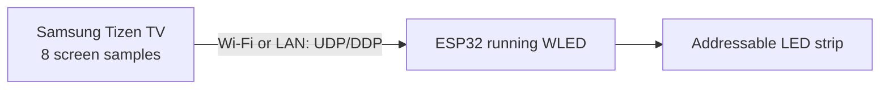

# HyperTizen WLED Direct

Ambient lighting from a Samsung Tizen TV directly to WLED over UDP/DDP. This project extends [lowryn/HyperTizen](https://github.com/lowryn/HyperTizen), a fork of [reisxd/HyperTizen](https://github.com/reisxd/HyperTizen). The original HyperHDR output remains available.

**Verified configuration:** Samsung QN75Q7FAAGCZB, Tizen 9, classic ESP32 with WLED, SM16703 strip with 120 physical LEDs grouped into 40 addressable RGB pixels. Netflix, YouTube, and TV were reported working on that device. Other models and firmware are untested.

## Contents

- [How it works](#how-it-works)
- [Features and limitations](#features-and-limitations)
- [Parts and wiring](#parts-and-wiring)
- [Set up WLED](#set-up-wled)
- [Install](#install)
- [Configure the LEDs](#configure-the-leds)
- [Build from source](#build-from-source)
- [Troubleshooting](#troubleshooting)
- [FAQ](#faq)
- [Credits and license](#credits-and-license)

## How it works



The TV samples eight positions around the picture using `libvideoenhance.so`, maps them to configurable LED zones, and sends RGB values to WLED on UDP port 4048. No PC, HyperHDR server, HDMI capture card, or camera is required during normal operation. A PC or compatible installer is needed for initial installation.

## Features and limitations

- Direct WLED/DDP mode, plus the original HyperHDR mode.
- Configurable WLED IP, addressable pixel count, pixels per side, first pixel, and strip direction.
- Optional interpolation at a target of about 30 DDP sends per second; configurable 50–500 ms transition (60 ms UI default).
- Performance logs and the TV UI distinguish **capture FPS** from **DDP send FPS**. Interpolation does not increase the real capture rate. The tested TV captures about 5–6 FPS in the eight-point mode. The new four-point mode has not yet been measured on that TV.
- Eight capture samples provide coarse spatial detail. Firmware and DRM behavior can vary. The experimental full-frame SecVideoCapture path is retained for HyperHDR only; it was not active on the tested TV.
- Compatibility with other Samsung TVs, Tizen versions, LED controllers, and protected content is not established.

## Parts and wiring

Typical materials: compatible Samsung Tizen TV, ESP32 running WLED, addressable RGB strip, correctly sized regulated 5 V supply, suitable wiring and connectors, and a logic level shifter if required by your strip. The tested SM16703 strip has 40 addressable groups, despite containing 120 physical LEDs.

**Electrical safety:** disconnect power before wiring. Connect the ESP32 ground, LED ground, and power-supply ground together. Connect data to the strip's **input** end. Power the strip from the external 5 V supply; do not draw strip current through the ESP32 or TV. Size the supply and wire gauge for the strip's worst-case current, add appropriate protection, and use power injection where needed. Check your strip's actual voltage and data requirements before connecting it. If unsure, ask a qualified person to check the wiring.

## Set up WLED

1. Flash and configure WLED using its [official installation guide](https://kno.wled.ge/basics/install-binary/).
2. Connect the ESP32 and TV to the same reachable local network. Give the ESP32 a stable address via DHCP reservation if possible.
3. In WLED, select the correct LED output/controller, pin, color order, and **addressable pixel** count. For the tested strip, enter 40 pixels, not 120 physical LEDs.
4. Enable WLED's real-time DDP input on UDP port 4048. Verify WLED accepts DDP before troubleshooting TV capture.

## Install

### Easier path: TizenBrew Installer Desktop (experimental for this package)

[TizenBrew Installer Desktop](https://github.com/reisxd/TizenBrewInstaller) supports selecting a local `.tpk` and re-signing packages for Tizen 7+ TVs. Its source code includes both paths, but installation of **this service package** through it has not been tested on another TV. Download only from its official releases, connect the TV in Developer Mode, select a future generic release `.tpk`, and follow its Samsung sign-in prompts. Keep a copy of any currently working package before replacing it. A `.tpk` signed for one person's TV is not a portable release asset.

There is no public generic binary in this repository yet. Until a release has been independently checked, use the source build below.

### Known working path: Tizen Studio

Install [Tizen Studio with the TV SDK](https://developer.samsung.com/smarttv/develop/getting-started/setting-up-sdk/installing-tv-sdk.html), enable Developer Mode on the TV, and create your own [Samsung certificate profile](https://developer.samsung.com/smarttv/develop/getting-started/setting-up-sdk/creating-certificates.html). In Windows PowerShell, from the repository root:

```powershell
dotnet build -c Release
$tizen = '<TIZEN_STUDIO>\tools\ide\bin\tizen.bat'
$packageDir = 'HyperTizen\bin\Release\tizen90'
& $tizen package -t tpk -s '<YOUR_CERTIFICATE_PROFILE>' -- "$packageDir\io.gh.reisxd.HyperTizen-1.0.0.tpk"
& $tizen install -n io.gh.reisxd.HyperTizen-1.0.0.tpk -- $packageDir
& $tizen run -p io.gh.reisxd.HyperTizen
```

Enter the ESP32 address **on the TV**, in the **HyperTizen WLED Direct** TizenBrew screen. Install [TizenBrew](https://github.com/reisxd/TizenBrew), open **Module Manager → Add GitHub Module**, and enter `matitoud/HyperTizen-WLED` (without `gh/`). Open the added module. This repository includes the root `package.json` that TizenBrew expects. Loading this public module still needs a TV test after publication; if it shows “Unknown Module”, check that the latest change is on GitHub and restart TizenBrew.

## Configure the LEDs

In **HyperTizen WLED Direct**, choose **WLED DDP** and enter the ESP32's local address in **IP de WLED** (for example `192.168.1.100`; use your own address). On the TV remote, use **Up/Down** to navigate, **OK** to open a field, the on-screen keypad to enter numbers, **Listo** to confirm, or **Back** to cancel. A thick yellow outline marks the focused control. Set the number of **addressable pixels** and the top, right, bottom, and left counts so their sum equals the total. Press **Guardar configuración de WLED**, then check **Activado**. The logical path begins at the top-left and runs clockwise. `First physical pixel` rotates the mapping; `Reverse strip direction` changes its direction.

For the tested 40-pixel setup, an initial layout is 12 top, 8 right, 12 bottom, 8 left. Adjust these values to your own physical wiring. To reduce lag, try **Captura rápida · 4 puntos** with a 60 ms transition, or disable smoothing. Fast capture reuses one validated sample per side for both zones on that side: fewer hardware batches, less spatial detail. It requires installing the updated service `.tpk`; updating only the TizenBrew module is insufficient. The TizenBrew UI updates measured capture FPS and DDP send rate about once per second.

The UI tries `127.0.0.1` first, then the TV's own IP obtained through Samsung's Network API. If detection fails, enter the TV's IP in **IP de esta TV** and select **Conectar con HyperTizen**. This is different from the ESP32 address and is saved only in the UI's local storage. The new service accepts configuration requests originating on the TV itself and rejects other network clients. Do not expose the configuration port to the Internet.

## Build from source

Requires the .NET SDK, Tizen Studio TV SDK, and a Samsung signing profile. Clone this repository, inspect the source, run `dotnet build -c Release` at its root, then sign and install as above. `HyperTizen` is the service; `HyperTizenUI` is the TizenBrew interface. The `bin/` and `obj/` folders and locally signed packages are intentionally excluded from Git.

## Troubleshooting

| Symptom | Check |
| --- | --- |
| No LEDs | TV and ESP32 network reachability; WLED DDP port 4048; WLED pixel count; service enabled and WLED mode selected. |
| Wrong side or direction | Adjust per-side counts, first pixel, and reverse direction. |
| Jerky movement | Enable smoothing; compare the capture FPS and DDP FPS in `WLED perf` logs. |
| Noticeable delay | Try four-point capture, a 60 ms transition, or disable smoothing. Compare real capture FPS before and after. |
| Installer rejects the package | Re-sign with your own Samsung certificate and TV's device ID; do not use another user's signed package. |
| Capture fails | This TV may not expose the eight-point `libvideoenhance.so` API; collect logs and report model/firmware. |
| The UI shows an old HyperHDR address while WLED works | Update the `HyperTizenUI` module. A saved address does not indicate a live connection or affect DDP output. |
| The UI says “Sin conexión con el servicio” | Enter the **TV's** IP in the connection panel and choose **Conectar con HyperTizen**. Check that the `.tpk` service is installed and running on port 8086. LEDs may continue using previously saved settings. The UI retries without reloading the page. |

## FAQ

**Does it need a PC while watching?** No. Installation and updates may need one.

**Does 30 FPS mean 30 FPS capture?** No. It is the target DDP send rate for interpolated colors. The verified eight-point capture rate is about 5–6 FPS; four-point capture still needs a TV measurement.

**Can it replace HyperHDR?** WLED direct mode can run without HyperHDR. HyperHDR remains an alternative output mode.

**Will it work on my Samsung?** Only the configuration above is verified. Please report your model, firmware, Tizen version, capture status, and LED setup in an issue.

## Credits and license

Original [HyperTizen by reisxd](https://github.com/reisxd/HyperTizen); performance and capture improvements by [lowryn](https://github.com/lowryn/HyperTizen); experimental SecVideoCapture research credited by lowryn to [SryEyes](https://github.com/lowryn/HyperTizen#experimental-secvideocapture-full-frame-nv12-path). This modification adds WLED DDP output, LED mapping, smoothing, performance diagnostics, and configuration controls. The original HyperHDR code remains. Licensed under [GNU GPL v3](LICENSE); keep the upstream notices and license when redistributing.

See the [Spanish main README](README.md), [CONTRIBUTING.md](CONTRIBUTING.md), [CHANGELOG.md](CHANGELOG.md), and [PUBLICATION_AUDIT.md](PUBLICATION_AUDIT.md).

The WLED Direct modification was led and tested on a real TV by **matitoud**, with assistance from **Codex (OpenAI)** in implementation, review, and documentation.
